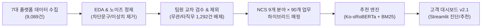

# [중간 보고 종합 브리핑] NCS 기반 인사(HR) 직무역량 분석 및 맞춤형 교육 추천 솔루션

---

## 📌 3분 핵심 요약 (Executive Summary)

* **문제 인식**: 초기 공공 API 수집 데이터는 분석 가능한 과정이 **단 9건**에 불과했고, 핵심 역량(채용·노무·평가) 강좌가 전무했습니다.
* **데이터 확장**: 국내 6대 교육 플랫폼(GSEEK, 휴넷, KPC, KMA 등) 및 고용24를 통합하여 **9,089건의 대규모 카탈로그**를 확보했습니다.
* **직무 범위 확정**: 초기 총무 직무를 포함했던 범위를 현업 요구에 맞춰 **인사(HR) 전문 9개 분야(90개 세부 업무)**로 고도화했습니다.
* **품질 감사 & EDA**: 890만 원 해외연수 이상치 분리, 0원 환급 강좌의 실체 규명, 1,331건의 크롤링 노이즈를 정제했습니다.
* **추천 & 대시보드**: 의미 기반 임베딩(Ko-sRoBERTa)과 키워드(BM25)를 결합한 **하이브리드 추천 엔진**을 탑재하고, 직급 진단부터 수강 신청까지 이어지는 **고객용 인터랙티브 Streamlit 대시보드**를 구현했습니다.

---

## 1. 어떤 데이터를 사용했는가? (Data Source & Scope)

### ① 데이터 수집 채널 및 규모
* **초기 한계**: 공공 직업훈련 API(고용24 등)로는 인사 직무 교육이 9건에 그쳐 실질적인 추천 모델 구축이 불가능했습니다.
* **수집 다원화**:
  * **공공 훈련 데이터**: 고용24(HRD-Net) 직무 교육 데이터
  * **민간·공공 6대 전문 교육기관 DB 전수 수집**: GSEEK(1,991건), 휴넷(1,958건), 한국능률협회(1,765건), 한국생산성본부(1,513건), 멀티캠퍼스(1,116건), 한국직업방송(162건)
  * **최종 데이터 풀**: **총 247개 교육기관, 9,089개 교육과정** 확보

### ② 직무 범위 최적화 (2026-10 팀 의사결정)
* 초기에는 '인사+총무'를 함께 검토했으나, 업무 성격이 상이하여 **인사(HR) 전문 직무로 타깃을 좁혔습니다.**
* **인사 표준 9개 분야 체계화**:
  1. 인사전략·인력기획
  2. 조직설계·직무분석
  3. 인재채용
  4. 온보딩·직원경험
  5. 성과평가·목표관리
  6. 보상·급여·복리후생
  7. 인재육성·사내교육
  8. 조직문화·사내소통
  9. 노사관계·노무
* 국가 표준(NCS) 능력단위와 연계하여 실무자가 수행하는 **90개 세부 과업(Task)** 마스터 테이블을 완성했습니다.

---

## 2. 어떻게 EDA(탐색적 데이터 분석)를 진행했는가?

### ① 텍스트 품질 및 결측치 정제
* **데이터 결측 분포**: 과정명·기관명은 100% 완전했으나 교육시간(44.5%), 난이도(38.1%), 과정소개(31.7%), 가격(22.4%) 등 결측 존재
* **노이즈 필터링**:
  * 휴넷 사이트의 '접속 차단 안내문' 크롤링 오류 **1,331건 전량 제거**
  * 홍보성 상용 문구(1,283건) 및 단순 이미지 base64 코드 제거
  * 상세 소개(200자 이상)가 존재하는 **고품질 텍스트 70.9%** 확보

### ② 수강료 및 데이터 왜곡의 통계적 규명
* **890만 원 해외연수 이상치(Outlier) 격리**:
  * 한국능률협회(KMA)의 '[해외] HR Tech 한국대표단(890만 원)'은 일반 직무 교육과 성격이 완전히 달라 통계 왜곡 방지를 위해 추천 제외군으로 분리
* **수강료의 비대칭 분포**:
  * 유료 과정 평균가는 46.8만 원이나, 고액 과정으로 인한 왜곡을 고려하여 통계적 대표값으로 **중앙값(28.0만 원 ~ 58.0만 원)** 채택
* **'0원 강좌'의 이중 구조 실증**:
  * 0원 강좌 중 경기도 GSEEK(17건), KPC(3건) 등은 '순수 무료 공개 강좌'
  * 고용24 사업주 훈련 과정(44건)의 0원은 실제 무료가 아니라 '기업이 납부 후 전액 환급받는 제도'임을 확인하여 사용자 안내 문구 세분화

### ③ 직무별 교육 공급의 불균형 발견
* **공급 과잉 영역**: '인재육성·사내교육(3,955건)', '온보딩·직원경험(3,059건)' 등 소프트스킬/기본 소양 과정 집중
* **공급 사각지대(희소 영역)**: '노사관계·노무(272건)', '보상·급여(283건)' 등 법률 및 하드스킬 기반 과정은 상대적으로 부족하여 맞춤형 발굴의 필요성이 확인되었습니다.
* **난이도 편중**: 입문·초급이 78.2%로 대다수이며, 중급(17.9%), 고급(3.9%) 과정은 매우 희소함을 확인했습니다.

---

## 3. 프로젝트는 어떻게 진행되었는가? (Pipeline & Recommender)

1. **데이터 통합 & 1:N 복합 역량 매핑**:
   * 초기에는 1개 과정을 1개 역량에만 묶었으나, "채용과 노동법" 같은 복합 과정을 위해 1:N 다중 역량 매핑 구조를 구축했습니다.
2. **도메인 전문가 수준의 팀원 전수 검수**:
   * 팀원 교차 검수를 통해 단순 안전교육, 마케팅·커머스, 타 직무 자격증 등 **1,292건의 무관 과정을 제외 목록(`off_topic`)으로 분리**하여 추천 신뢰도를 극대화했습니다.
3. **하이브리드 추천 알고리즘 설계**:
   * **Semantic 임베딩 (`jhgan/ko-sroberta-multitask`)**: 90개 세부 과업의 직무기술서 문맥과 교육 과정 상세 설명 간 의미적 유사도 산출
   * **Lexical 매칭 (BM25)**: 핵심 직무 용어의 정확한 일치 보정
   * **직급/난이도 가중치**: 주니어(입문·초급), 시니어(관리자·심화)별 최적 난이도 필터링
   * *(환경 제약 시 BM25 기반으로 자동 폴백되는 고가용성 구조 설계)*

---

## 4. 대시보드 구성 및 사용 방법

현재 서비스는 실무자가 사용하는 **고객 서비스 앱**과 연구용 **통합 분석 대시보드** 두 가지로 구축되어 있습니다.

### ① 실무자용 맞춤형 고객 서비스 (`customer_dashboard/`)
* **실행**: `streamlit run app.py`
* **주요 플로우 (3단계 안내형)**:
  1. **1단계 [내 위치]**: 주니어(1~3년 차), 미드(4~7년 차), 시니어 등 본인의 연차와 직급 선택
  2. **2단계 [업무 진단]**: 인사 9개 분야별 90개 세부 업무 중 본인이 실제로 겪고 있는 부족한 업무 체크
  3. **3단계 [맞춤 추천]**: 선택한 취약 과업에 최적화된 Top 3 추천 교육, 교육기관, 공식 만족도, 수강료 및 링크를 즉시 제공
  4. **부가 기능**: 7,797개 유효 교육 통합 검색창 및 나의 학습 계획(담아두기) 기능

### ② 프로젝트 발표 및 웹 전시용 대시보드
* **웹 프레젠테이션 (`presentation/`)**: [https://hr-edu-map.vercel.app](https://hr-edu-map.vercel.app)에 배포되어 있으며, 수치 지표와 차트를 슬라이드 형태로 시각화
* **내부 분석 대시보드 (`app/streamlit_integrated.py`)**: 10개 탭으로 구성되어 원천 데이터 분포, 클러스터링, 추천 시뮬레이션 결과를 상세하게 제공

---

## 5. 향후 계획 (Next Steps)

1. **추천 모델 성능 정밀 튜닝**: 실무자 블라인드 테스트 및 정밀 평가(NDCG, Precision@K) 지표 측정
2. **공식 만족도 피드백 연동**: 국비 훈련과정의 고용24 실제 훈련 만족도 점수를 가중치에 단계적 반영
3. **배포 안정화**: Streamlit Cloud 및 경량 패키지 최적화로 서비스 반응 속도 1초 이내 단축

---

## 🎙️ 실전 발표용 대본 (2~3분 구두 브리핑용)

> "안녕하십니까, **[NCS 기반 인사 직무역량 분석 및 맞춤형 교육 추천]** 프로젝트 중간 발표를 맡은 [발표자 이름]입니다.
> 
> **첫째, 데이터 수집과 범위 설정입니다.**  
> 저희가 처음 공공 API로 수집했을 때, 인사 직무로 분류할 수 있는 과정은 단 9건에 불과했고 노무나 채용 같은 핵심 교육은 전무했습니다.  
> 이를 극복하기 위해 휴넷, 생산성본부, 능률협회, 경기도 GSEEK 등 국내 대표 6개 교육기관의 DB를 전수 수집하여 총 9,089건의 방대한 교육 카탈로그를 확보했습니다.  
> 또한 직무 성격이 다른 총무를 제외하고, 인사 9개 분야와 90개 실무 과업에 명확히 집중하도록 범위를 정립했습니다.
> 
> **둘째, EDA와 정밀 품질 감사 결과입니다.**  
> 데이터를 분석하는 과정에서 크롤링 오류로 들어온 1,331건의 접속 차단 문구를 정제했고, 일반 교육 풀을 왜곡시킬 수 있는 890만 원짜리 해외연수 과정을 발견하여 이상치로 분리했습니다.  
> 또 0원 강좌 중 진짜 무료인 공공 e-러닝과 사업주가 환급받는 훈련 과정을 통계적으로 명확히 규명했습니다.  
> 특히 온보딩이나 일반 사내교육은 공급이 넘치지만, 정작 실무에 필수적인 노사관계·급여 과정은 300건 미만으로 매우 희소하다는 '스킬-갭'을 데이터를 통해 확인했습니다.
> 
> **셋째, 추천 알고리즘과 대시보드 구현입니다.**  
> 직무와 무관한 강좌 1,292건을 팀원 전수 검수로 걸러낸 뒤, 한국어 문맥 임베딩(Ko-sRoBERTa)과 키워드(BM25)를 결합한 하이브리드 추천 모델을 만들었습니다.  
> 이를 바탕으로 제작된 고객 대시보드(`streamlit run app.py`)에서는 사용자가 자신의 직급을 고르고 부족한 업무를 체크하면, 7천여 개 강좌 중 해당 업무를 해결해 줄 최적의 강의를 난이도와 직급에 맞춰 실시간으로 추천해 줍니다.
> 
> 남은 기간 동안 추천 만족도를 검증하고 웹 서비스를 배포하여 누구나 쉽게 자신의 커리어 빈틈을 채울 수 있도록 완성하겠습니다. 경청해 주셔서 감사합니다."
